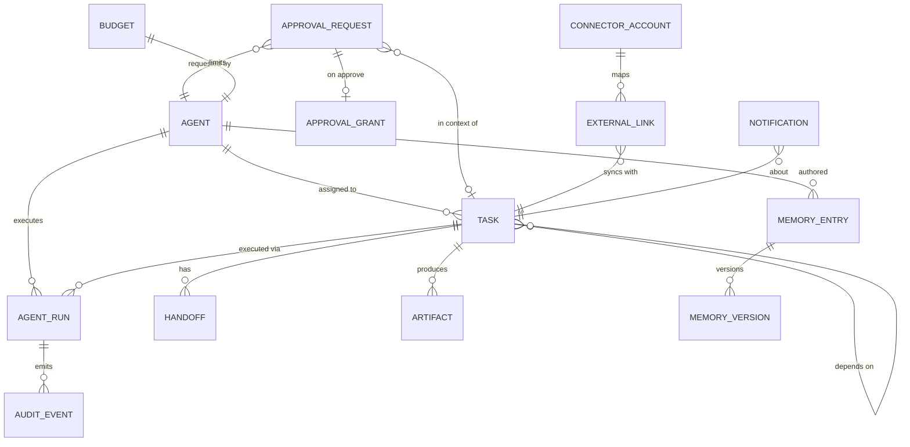

# Data Model Overview: FLUX-88

**Date**: 2026-11-06 · Entity-level design; exact columns finalized in Drizzle schema
during Phase 0b/1 implementation. All tables live in PostgreSQL (system of record).

## Entity map



## Entities

### agents
Fixed roster of 18 rows, seeded, never created/deleted at runtime (FR-001).
- `id` (stable slug: `doc`, `eleven`, `data`, `egon`, `claire`, `tron`, `andie`, `mikey`,
  `jem`, `sloane`, `marty`, `ripley`, `kitt`, `johnny-five`, `sarah`, `robin`, `max`,
  `ferris`)
- `display_name`, `department` (management|design|engineering|content_business),
  `office_area`, `role_summary`, `personality` (presentation only)
- `config` JSONB validated by the registry zod schema (see agents.md): objectives,
  allowed_tools[], data_scopes[], prohibited_ops[], io_contract, clarification_rules,
  handoff_targets[], escalation_rules, memory_permissions, error_policy, budgets
- `enabled`, `status` (idle|running|blocked), timestamps

### tasks
- `id`, `title`, `description`, `status` ∈ {backlog, ready, running, blocked, review,
  awaiting_approval, completed, failed, canceled} (FR-011; transitions enforced by the
  `packages/core` state machine)
- `creator` (owner|agent id|connector), `assignee_agent_id?`, `parent_task_id?`
- `priority`, `deadline?`, `retry_count`, `retry_limit`, `delegation_depth`
- `origin` (local|github|trello) + `origin_ref?` for imported tasks (FR-010)
- `simulated` boolean — distinguishes demo/mock activity (FR-053)
- cost rollups: `tokens_used`, `cost_cents`, `exec_ms` (FR-016)

### task_dependencies
- `task_id` → `depends_on_task_id`; DAG enforced (cycle check on insert; FR-015)

### handoffs
- `id`, `task_id`, `from_agent_id`, `to_agent_id`, `reason`, `payload_ref?`, `created_at`
  (FR-004; immutable)

### agent_runs
One LLM-or-mock execution of an agent against a task.
- `id`, `task_id`, `agent_id`, `provider` (claude|mock), `model?`, `status`
- `input_tokens`, `output_tokens`, `cost_cents`, `duration_ms` (FR-016)
- `idempotency_key` (dedupe, FR-017), `error?`, `simulated`

### approval_requests  *(immutable after creation)*
- `id`, `requesting_actor_type` (owner|agent), `requesting_agent_id` (required for agents, null for owner requests), `action_type` (one of FR-030 categories), `action_payload`
  (exact proposed action), `target_resource`, `expected_impact`, `risks`, `expires_at`
- `status` ∈ {pending, approved, rejected, expired}, `decided_by?`, `decided_at?`, `decision_reason`
- `dedupe_key` unique; immutable proposal and one-way decision fields are trigger-protected
- `batch_id?` for explicitly defined batches (FR-033); every grant remains single-use for the whole exact payload

### approval_grants  *(single-use capability)*
- `id`, `approval_request_id` (unique), `consumed_at?`, `consumed_by_run_id?`
- Grant is minted by the API on approval, passed to the connector write, marked consumed
  in the same transaction as the outbox record (FR-033; scenario 7)

### memory_entries
- `id`, `scope` (shared|project|private), `project_id?`, `category`
- `title`, `body`, `source_attribution`, `confidence` (0–1)
- `verification_status` ∈ {verified, proposed, untrusted} (FR-021/FR-025)
- `author` (agent id|owner), `embedding vector?`, FTS column (keyword search)
- `revoked_at?` (revocation keeps history, hides from search; FR-022)
- `dedupe_hash`, `conflicts_with?[]` (surfaced, not auto-resolved)
- Write-permission matrix per (agent, category) lives in agent config (FR-023);
  secret-shaped content rejected at write (FR-024)

### memory_versions
- `memory_entry_id`, `version`, `body`, `edited_by`, `edited_at`, `change_note`

### audit_events  *(append-only; app DB role has INSERT/SELECT only)*
- `id`, `actor_type` (owner|agent|system|connector), `actor_id`, `action`, `target_type`,
  `target_id`, `payload` JSONB, `created_at` (FR-070)

### connector_accounts
- `id`, `provider` (github|discord|trello|mock), `mode` (read_only|write_enabled)
- `config` (non-secret), `health_status`, `last_sync_at` (secrets stay in env; FR-044)

### external_links
- `provider`, `external_type/id` ↔ `task_id`; `origin_marker` prevents sync loops (FR-043)

### notifications
- `id`, `channel` (dashboard|discord), `task_id?`, `approval_request_id?`, `body`
- `dedupe_key` (at-most-one reminder per interval; scenario 5), `quiet_hours_deferred`,
  `sent_at?`

### budgets
- `agent_id`, `window` (per_run|daily), `max_tokens`, `max_cost_cents`, `max_runtime_ms`,
  `max_retries`; consumption read from agent_runs rollups (FR-016, Principle VIII)

### owner / session tables
- `owner` (single row: email, argon2id hash, failed_attempts, locked_until?)
- `sessions` (framework-managed; re-issued on login; FR-072 + constitution security rules)

### outbox
- Transactional outbox for external writes: `id`, `connector`, `operation`, `payload`,
  `grant_id`, `status`, `attempts`, `idempotency_key` — guarantees no duplicate external
  action on retry (scenario 9, risk 4)

## State machine (tasks)

```
backlog → ready → running → review → completed
             ↘ blocked ↗   ↘ awaiting_approval → running
running → failed (retry_limit reached) | canceled (owner)
any non-terminal → canceled (owner)
```

Transitions only via `packages/core` guards; every transition writes an audit event.
