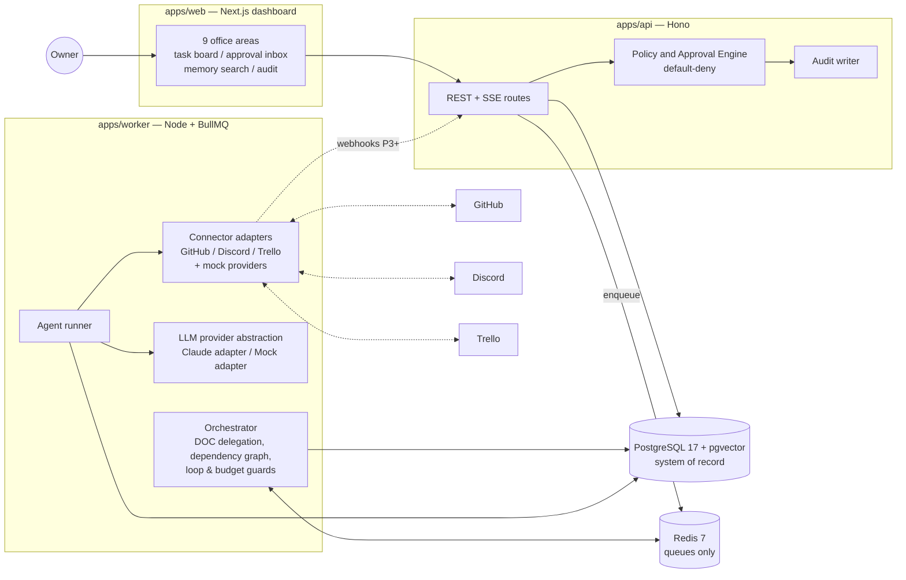

# Implementation Plan: FLUX-88 — 18-Agent Retro AI Office Platform

**Branch**: `feature/issue-3-phase-0-spec` (spec `001-flux-88-platform`) | **Date**: 2026-11-06 | **Spec**: [spec.md](./spec.md)

**Input**: Feature specification from `specs/001-flux-88-platform/spec.md`

## Summary

FLUX-88 is a self-hostable, single-user-first orchestration platform running 18 fixed AI
agents. The technical approach is a TypeScript pnpm monorepo with four runtime services —
Next.js dashboard, Hono API, BullMQ worker, PostgreSQL/Redis — a typed agent registry, a
default-deny policy/approval engine enforced in the API layer, a pgvector-backed Memory
Vault, and adapter-pattern connectors (GitHub/Discord/Trello) that are mocked for local
development. Phase 1 delivers the full product surface against a deterministic mock LLM;
Phase 2 swaps in real Claude calls behind a provider abstraction without changing the
surrounding architecture.

## Technical Context

**Language/Version**: TypeScript 5.x on Node.js 22 LTS (ESM throughout)

**Primary Dependencies**: Next.js (App Router) + React; Tailwind CSS + shadcn/ui; Hono
(typed HTTP API, zod validation); Drizzle ORM; BullMQ; `@anthropic-ai/sdk` behind a
provider abstraction; octokit / discord.js / Trello REST behind connector adapters

**Storage**: PostgreSQL 17 (+ pgvector extension) for all durable state; Redis 7 for
queues and ephemeral coordination only (never the system of record)

**Testing**: Vitest (unit + integration), Playwright (e2e), Testcontainers or
docker-compose services for integration tests; failure-injection suite for scenario 9

**Target Platform**: Self-hosted Linux/macOS via Docker Compose; dev on a laptop with no
paid credentials (mock LLM + mock providers)

**Project Type**: Web application monorepo (frontend + API + worker + shared packages)

**Performance Goals**: Dashboard first load < 3s locally; keyword memory search < 2s
(SC-004); mock-mode task decomposition visible < 30s (SC-002); concurrency-limited
parallel agent runs (default 3)

**Constraints**: Single-owner deployment; everything recoverable after restart (SC-003);
no external side effects without policy-engine authorization

**Scale/Scope**: 1 owner, 18 agents, thousands of tasks/memory entries; ~11 dashboard
views; no multi-tenant scaling requirements through P4

## Constitution Check

*GATE: evaluated against constitution v1.0.0 — all gates PASS (initial and post-design).*

| Principle | Status | How the plan complies |
|---|---|---|
| I Human control | PASS | Policy engine + approvals table enforced in API before any connector write; approvals single-use, expiring, revalidated at execution |
| II Least privilege | PASS | Per-agent scope allowlists in registry; policy checks use agent identity, not DOC's; secrets only in env/secret store; untrusted-content labeling in memory |
| III Reliable persistence | PASS | Postgres as sole system of record; BullMQ jobs idempotent with dedupe keys; Redis treated as disposable |
| IV Traceability | PASS | Append-only `audit_events`; handoffs recorded as rows; simulated vs real runs flagged on every execution record |
| V Testability | PASS | Mock LLM + mock connectors are first-class adapters; acceptance scenarios 1–10 each map to an automated test |
| VI Maintainability | PASS | Module boundaries below; no microservices — 3 deployable processes + DB/Redis |
| VII Minimal side effects | PASS | Connectors read-only by default; write methods require an `ApprovalGrant` token parameter by construction |
| VIII Cost awareness | PASS | `agent_runs` records tokens/time/cost; budget middleware halts over-budget runs |
| IX Spec-first | PASS | This plan follows spec.md; implementation starts only after /speckit-tasks and owner GO |
| X Accessibility | PASS | shadcn/ui primitives (Radix) + reduced-motion media query + WCAG checks in e2e |

## Architecture



Key boundary: **only the API process evaluates policy and mints approval grants**; the
worker refuses connector writes that don't carry a valid, unconsumed grant, and connectors
require the grant in their method signatures (capability style), so bypassing approval is a
type error, not just a runtime check.

## Project Structure

### Documentation (this feature)

```text
specs/001-flux-88-platform/
├── plan.md              # This file
├── spec.md              # Product specification
├── research.md          # Phase 0 decisions and alternatives
├── data-model.md        # Entity/field/relationship overview
├── agents.md            # 18-agent registry mapping + exemplar config
├── quickstart.md        # Local validation guide
├── checklists/requirements.md
├── contracts/api.md     # HTTP API contract overview
└── tasks.md             # Created later by /speckit-tasks
```

### Source Code (repository root — created in Phase 0b scaffolding)

```text
apps/
├── web/                 # Next.js App Router dashboard (office areas, inbox, boards)
│   ├── app/             #   routes: /clock-tower /hawkins-lab /arcade /garage
│   │                    #           /ghost-lab /front-desk /video-store /mall /vault
│   └── components/      #   retro design system on Tailwind + shadcn/ui
├── api/                 # Hono HTTP API + SSE; policy engine lives here
│   └── src/
│       ├── routes/      #   tasks, agents, approvals, memory, integrations, audit
│       ├── policy/      #   default-deny rules, approval grants, revalidation
│       └── auth/        #   owner session auth (constitution security rules)
└── worker/              # persistent orchestration service
    └── src/
        ├── orchestrator/ #  DOC delegation, dependency graph, loop/budget guards
        ├── runner/       #  agent execution lifecycle, retries, recovery
        └── queues/       #  BullMQ definitions, idempotency keys

packages/
├── core/                # domain types, task state machine, event types (zero deps)
├── db/                  # Drizzle schema, migrations, repositories
├── agents/              # typed agent registry: 18 configs + zod schema + prompts
├── memory/              # Memory Vault: search (keyword + vector), write rules
├── llm/                 # provider abstraction: ClaudeProvider, MockProvider
├── connectors/          # github/ discord/ trello/ + mock/ implementations
└── config/              # env parsing, feature flags (.env.example source of truth)

infra/
├── docker-compose.yml   # postgres+pgvector, redis, api, worker, web
└── init/                # DB init, seed (18 agents, demo data flagged simulated)

e2e/                     # Playwright suites incl. accessibility checks
```

**Structure Decision**: pnpm workspace monorepo, three deployable apps sharing seven
internal packages. The dev-time Claude Code subagents (`.claude/agents/`) are intentionally
separate from `packages/agents` (the application runtime registry) — the former assists
development, the latter ships with the product. `.claude/` is currently gitignored
(Open Decision 1 in spec.md).

## Module Boundaries

| Module | Owns | Must not touch |
|---|---|---|
| `apps/web` | Presentation, owner interactions | DB directly, connectors, LLM |
| `apps/api` | AuthN/Z, policy + approvals, CRUD, SSE, audit writes | LLM calls, long-running work |
| `apps/worker` | Orchestration, agent runs, connector I/O, schedules | HTTP auth, policy decisions (consumes grants only) |
| `packages/core` | Domain types + state machines | I/O of any kind |
| `packages/db` | Schema, migrations, repositories | Business rules |
| `packages/agents` | Registry schema, 18 configs, prompt assembly | Execution, I/O |
| `packages/memory` | Vault search/write rules, embeddings interface | Policy decisions |
| `packages/llm` | Provider abstraction, token accounting | Task state |
| `packages/connectors` | Provider adapters + mocks, rate limits, dedupe | Executing without an ApprovalGrant for writes |

## Security Boundaries

1. **Owner ↔ dashboard**: password login per constitution (Argon2id, generic errors,
   5-failure lockout, session re-issue, Secure/HttpOnly/SameSite cookies, CSRF tokens on
   all mutations).
2. **Dashboard ↔ API**: session-authenticated; all input zod-validated server-side; SSE
   for live updates.
3. **Worker ↔ API/DB**: worker runs with its own least-privilege DB role; it cannot mint
   approval grants.
4. **Agents ↔ world**: agents only reach the outside through connector adapters; connector
   write methods require an unconsumed `ApprovalGrant`; reads are scope-checked against the
   agent registry.
5. **External content ingress**: webhook payloads, crawled files, and LLM tool outputs are
   tagged `untrusted` at the boundary and keep that tag through memory and prompts; prompt
   assembly renders untrusted content inside clearly delimited data blocks, never as
   system/instruction text (scenario 8).
6. **Secrets**: env-only via `packages/config`; a write-time scanner rejects
   secret-shaped strings entering the Memory Vault (FR-024); logs are structured and
   scrubbed.

## MVP (Phase 1) Boundaries

In: all [P1] requirements — 18 configurable agents, task board + lifecycle, DOC delegation
with **mock** LLM, persistent state, Memory Vault (keyword search required; vector wiring
with local mock embedder), approval engine + inbox (local actions), full dashboard with all
nine areas, audit trail, owner auth, Docker Compose up with zero credentials.

Out (deferred): real LLM calls (P2), durable multi-step recovery beyond restart-safety
(P2), QA automation by EGON (P2), GitHub/Discord live connectors + webhooks (P3), Trello
(P4), video/sales pipelines (P4).

## Prioritized Delivery Sequence

1. **Phase 0b — scaffold** (next issue/PR): pnpm monorepo, Docker Compose
   (postgres+pgvector, redis), `.env.example`, CI gates (lint/typecheck/test), empty apps
   boot.
2. **P1 slice 1 — US5 shell**: owner auth (constitution hardening), dashboard shell with
   nine areas, agent directory seeded with all 18 agents, theme + reduced motion.
3. **P1 slice 2 — US1 core**: task CRUD + state machine, DOC mock delegation, dependency
   graph, timeline, audit trail.
4. **P1 slice 3 — US3 Memory Vault**: entries, permissions, keyword search, pgvector
   wiring with mock embedder, versioning/revocation.
5. **P1 slice 4 — US2 approvals**: policy engine, approval inbox, single-use grants,
   outbox.
6. **P1 slice 5 — US4 hardening**: restart/failure-injection tests, budgets surface,
   acceptance suite for scenarios 1–3, 6–10 (mock), demo polish.
7. **Phase 2** real LLM execution → **Phase 3** GitHub/Discord → **Phase 4** Trello +
   content pipelines (each via `/speckit-tasks` and owner GO per phase).

## Risks & Mitigations

| # | Risk | Impact | Mitigation |
|---|---|---|---|
| 1 | Approval bypass via code path that skips policy | Critical | Capability-style grants in connector signatures; adversarial tests (scenarios 6–8); single policy module |
| 2 | Prompt injection from crawled content | High | Untrusted tagging end-to-end, delimiter rendering, no instruction elevation, permission immutability tests |
| 3 | Orchestration loops / runaway cost | High | Delegation depth limit, cycle detection on the task graph, per-run budgets enforced in runner |
| 4 | Duplicate external actions on retry | High | Idempotency keys on jobs + single-use grants + outbox pattern for connector writes |
| 5 | Scope creep of 18 personalities into logic | Medium | Personality limited to prompt/presentation fields; permissions only from registry scopes |
| 6 | Retro theme vs accessibility | Medium | Tokenized theme with AA-checked palettes; reduced-motion mode; axe checks in e2e |
| 7 | pgvector/embedding cost in MVP | Low | Mock embedder locally; interface allows swapping real embeddings in P2 |
| 8 | BullMQ/Redis loss | Medium | Redis is rebuildable; task truth in Postgres; startup reconciliation re-enqueues from DB |

## Complexity Tracking

No constitution violations to justify. The three-process split (web/api/worker) is the
minimum that satisfies Principle III (durable background execution) and Principle I
(policy enforcement isolated from execution).
