# Phase 3 GitHub and Discord Collaboration Plan

**Branch**: `feature/issue-72-phase3-plan` | **Date**: 2026-11-22 | **Spec**: [spec.md](./spec.md)

**Input**: Phase 3 requirements in `specs/001-flux-88-platform/spec.md`, narrowed to GitHub review feedback and optional Discord notifications/interactions.

## Summary

Implement Phase 3 as small, separately reviewable slices. Start with explicit task-to-PR links and read-only GitHub feedback ingestion; persist feedback with provider IDs and untrusted provenance; then add deduplicated notifications, quiet-hours scheduling, and optional Discord delivery. Discord commands and approval actions must authenticate the interaction and delegate to existing task/approval services. All writes remain grant-bound through the existing policy and outbox path.

## Technical Context

**Language/Version**: TypeScript 5.x, Node.js 22, ESM

**Primary Dependencies**: Existing Hono, Drizzle, BullMQ and Vitest; GitHub REST client and Discord HTTP/API tooling to be selected in the implementation issue after compatibility review. No gateway or privileged message-content intent is required for signed application interactions.

**Storage**: PostgreSQL 17 is authoritative; Redis/BullMQ is disposable delivery coordination.

**Testing**: Vitest unit/contract/integration tests using injected mock adapters and a disposable database; Playwright only for dashboard flows changed by the feature.

**Target Platform**: Self-hosted Linux/macOS; external connectors stay disabled by default.

**Project Type**: TypeScript web/API/worker monorepo.

**Performance Goals**: One sync cycle must process bounded pages and honor provider rate limits; notifications are deduplicated and not sent during configured quiet hours.

**Constraints**: Read-only provider mode by default; secrets only in server environment; external text is untrusted; no live credentials in CI; existing policy/approval/outbox path remains the only remote-write path.

**Scale/Scope**: Single owner, an explicit repository allowlist, one configured Discord destination, and the current 18-agent registry.

## Constitution Check

| Principle | Status | Design response |
|---|---|---|
| I Human control | PASS | Discord approvals call the existing exact-request approval lifecycle; no message text grants general authority. |
| II Security & least privilege | PASS | Server-side allowlists, verified Discord signatures, minimal read scopes, secrets in env only, provider content marked untrusted. |
| III Reliable persistence | PASS | PostgreSQL stores source IDs, mappings, feedback and notification state; unique identities make retries safe. |
| IV Traceability | PASS | Sync, mapping, notification and approval events are audited with actor/source attribution. |
| V Testability | PASS | Mock adapters remain default; provider calls are injected and all tests run without external credentials. |
| VI Maintainability | PASS | Extend `packages/connectors`, existing API/worker boundaries and schema; no new service. |
| VII Minimal external side effects | PASS | GitHub reads only by default; any external write must use existing grant-bound outbox. |
| VIII Cost awareness | PASS | Polling is bounded, serialized per account, and respects provider limits; no LLM call required for mapping. |
| IX Spec-first | PASS | This scoped spec and tasks precede implementation issues. |
| X Accessible UI | PASS | Feedback and notification controls use existing semantic dashboard patterns and keyboard-accessible forms. |

## Architecture

```mermaid
flowchart LR
  GH[GitHub REST API] -->|read-only bounded sync| GW[GitHub adapter]
  GW --> ING[Feedback ingestion]
  ING --> PG[(PostgreSQL: external links, feedback, audit)]
  ING --> API[Activity API / SSE]
  PG --> NOTIFY[Notification scheduler]
  NOTIFY -->|quiet hours + unique delivery key| Q[(BullMQ)]
  Q --> BATCH[Exact message batch]
  BATCH --> OWNER[Owner approval inbox]
  OWNER --> OBD[Outbox dispatcher]
  OBD -->|matching time-limited communication grant| DA[Discord adapter]
  DA --> DC[Discord API]
  DC -->|signed interaction| INT[Discord interaction route]
  INT --> AUTH[Verify signature + configured owner]
  AUTH --> APPROVAL[Existing task / approval service]
  APPROVAL --> OUTBOX[Policy-bound outbox]
  OUTBOX -->|valid single-use grant only| GH
```



GitHub and Discord implementations conform to typed, injected adapter interfaces with mock counterparts. GitHub ingestion uses explicit external-link records; unmatched feedback is stored for owner review and is never assigned through fuzzy matching. Discord delivery is queued from durable notification state and observes quiet hours. Because outbound Discord messages are external communications, each delivery batch requires owner approval of the exact messages and destination; every send then uses its own single-use grant through the existing outbox. Discord interactions use a public HTTP endpoint, verify the raw-body signature and freshness, then verify the configured owner identity before delegating to existing API services. Provider payloads remain untrusted data throughout storage, display and prompt assembly.

## Project Structure

```text
packages/connectors/src/{github,discord}/       # typed live adapters + mocks
packages/db/src/schema/index.ts                  # feedback identity/persistence
packages/db/src/migrations/                      # unique provider/delivery keys
apps/worker/src/connectors/                      # bounded sync and notification jobs
apps/api/src/routes/integrations.ts              # sync status, feedback and interaction endpoint
apps/api/src/policy/                             # reuse current approval service
apps/web/app/(office)/clock-tower/activity/      # pending feedback and links
apps/web/app/(office)/clock-tower/integrations/  # health and configured mode
```

**Structure Decision**: Extend existing packages and services. Keep provider calls out of the browser and API request path except for the small signed Discord interaction callback; perform polling and notification delivery in the worker.

## Risks and Mitigations

- Missing task-to-PR mappings: surface unmatched records; require explicit owner linking.
- Duplicate events or worker restarts: persist provider event IDs and unique notification delivery keys transactionally.
- Prompt injection in external content: retain untrusted provenance and use existing prompt delimiters.
- Discord spoofing or replay: verify Ed25519 signature over timestamp plus raw request body and reject stale requests before parsing commands.
- API rate limiting: request only required fields, serialize polling, use conditional requests where available, and honor retry/reset headers.
- Credential overreach: allowlist repositories and destinations; document minimum scopes; never store secrets in connector JSON or logs.
- Accidental external writes: do not add direct write methods to read-only adapters; all future write execution requires the existing approval grant/outbox contract.

## Complexity Tracking

No constitution violations or new service boundaries are proposed.
